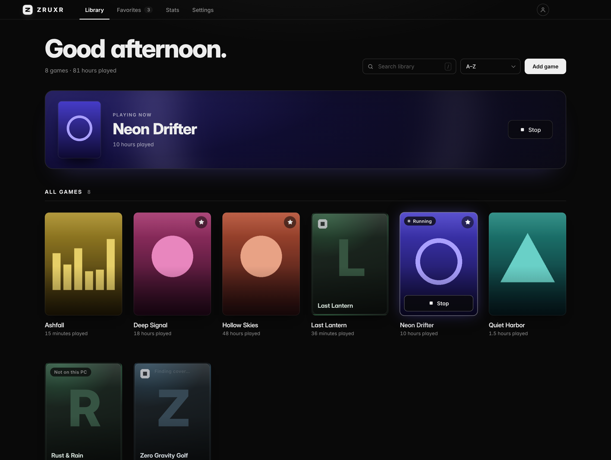
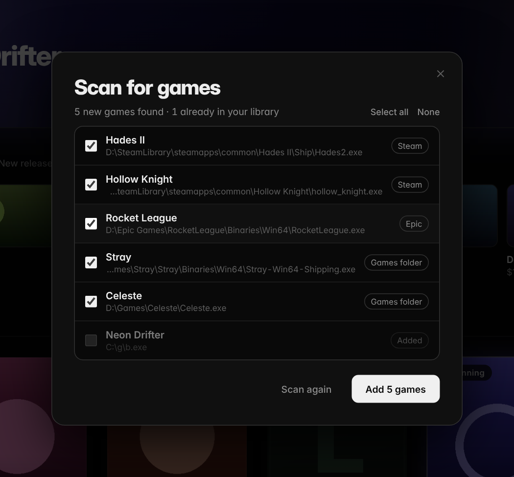
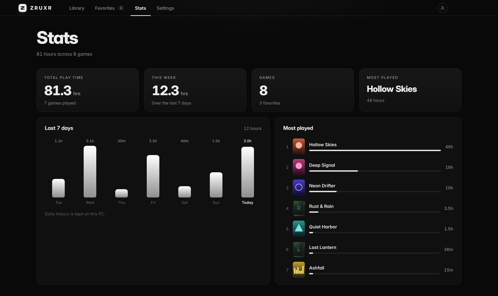
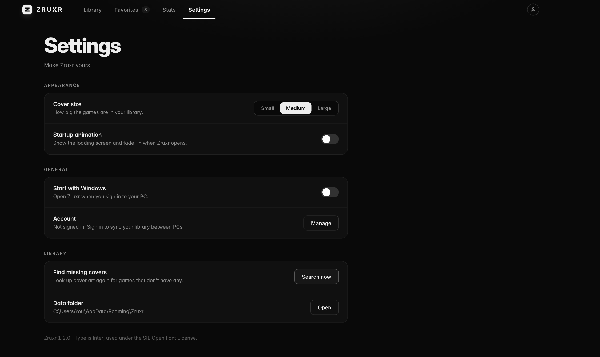

<div align="center">


# ZRUXR

**Your games. Your files. No store.**

A fast, dark game launcher for Windows. Point it at any `.exe` and Zruxr finds the cover art, tracks your play time, and keeps your library looking sharp.

[](../../releases/latest)


<br />



</div>

<br />

## Why Zruxr

Most launchers want you to buy things. Zruxr doesn't sell anything. It's for the games you already have: installed from a disc, downloaded from a developer's site, from an itch.io zip, or sitting in a folder on your drive. Add the `.exe`, and it looks and feels like the rest of your library.

## Features

**Find your games for you.** Press **Scan PC** and Zruxr finds games already installed: Steam libraries (read from Steam's own files), Epic, GOG and your Games folders. Tick the ones you want and add them in one go. "Whole PC" mode searches every drive, and you can also scan a single folder. It only reads folder and file names, nothing is changed or uploaded.

**Discover, kept small.** A slim row on the home page shows what's popular on Steam right now: top sellers, top free, new releases and what's on sale. Click a game to open its store page. Hide it with one click, or turn it off in Settings.

**Cover art, automatically.** Add a game and Zruxr looks it up by name (and by its folder name) and downloads the portrait art. You never upload an image. If a game can't be found, it gets a clean generated cover instead, and Zruxr checks again once a week.

**Play time that tracks itself.** Launch from Zruxr and the clock runs until the game closes. Totals are saved as you play, and a "Jump back in" banner always puts your last game one click away.

**A library that feels good.** Hover a cover for Play, star your favorites, sort by name, last played, most played or recently added, and press `/` to search. Each cover's main colour becomes the soft glow behind it.

**Stats you'll actually look at.** Total hours, this week's hours, a 7-day chart and your most played games.

**Updates itself.** The installed version checks GitHub Releases, downloads new versions in the background and installs them when you close Zruxr.

**Accounts are optional.** Zruxr works fully without one. If you do create a free account, your game list and play time follow you between PCs.

**Yours to tweak.** Small, medium or large covers, start with Windows, and a startup animation you can turn off.

## Screenshots

<table>
  <tr>
    <td width="50%">
" alt="Zruxr easy setup installer" /></td>
    <td width="50%"></td>
  </tr>
  <tr>
    <td align="center"><sub>Easy setup</sub></td>
    <td align="center"><sub>Scan PC finds your installed games</sub></td>
  </tr>
  <tr>
    <td width="50%"></td>
    <td width="50%"></td>
  </tr>
  <tr>
    <td align="center"><sub>Stats</sub></td>
    <td align="center"><sub>Settings</sub></td>
  </tr>
</table>

> The games shown above are made-up examples.

## Download

Grab the latest build from the [**Releases**](../../releases/latest) page:

| File | What it is |
| --- | --- |
| `Zruxr-Portable-x.y.z.exe` | One file. Double-click to run, no install. |
| `Zruxr-Setup-x.y.z.exe` | Installer with Start menu and desktop shortcuts, plus an uninstaller. Updates itself. |

Windows SmartScreen may warn about an unknown publisher because the app isn't code-signed. Choose **More info**, then **Run anyway**.

## Using it

1. Click **Scan PC** to find installed games, tick the ones you want and press **Add**. Or click **Add game** and choose a game's `.exe` (or `.bat` / `.cmd`) yourself.
2. Confirm the name if you added one by hand. The name is what's used to find the cover.
3. Hover the cover and press **Play**, or double-click it.

If a cover is wrong or missing, hover the game, click **Edit**, fix the name, or pick your own image. **Find automatically** switches back.

**Shortcuts:** `1` to `5` switch tabs, `/` searches, `Esc` clears the search.

Your library is saved in `%APPDATA%\Zruxr\library.json`, with covers in a `covers` folder beside it and your preferences in `settings.json`.

## Run from source

You'll need [Node.js](https://nodejs.org) (LTS).

```bash
npm install
npm start
```

### Build your own .exe

Run these on Windows, in the project folder, after `npm install`:

| Command | Output (in `dist/`) |
| --- | --- |
| `npm run dist:portable` | Portable single-file `.exe` |
| `npm run dist:setup` | NSIS installer |
| `npm run dist` | Both |

The app icon is `build/icon.png`. Swap it for your own image (at least 256 x 256) before building.

<details>
<summary><b>If Electron says it "failed to install correctly"</b></summary>

Newer versions of npm block install scripts by default, which stops Electron from downloading its binary. Approve the script and rebuild:

```bash
npm install-scripts approve electron
npm rebuild electron
```

If that still doesn't work, delete `node_modules` and run `npm install` again.

</details>

## Accounts and sync

An account is completely optional. Zruxr asks once when it opens, and you can click **Not now** to use everything offline. Accounts use [Supabase](https://supabase.com). People sign in with a username and password, and the app handles the rest. Sign-in sessions are stored encrypted with Windows' own credential protection, so you stay signed in between launches. There is no email on an account, so there is no password reset: a forgotten password can't be recovered.

If you fork this and want your own backend, create a Supabase project, then replace `SUPABASE_URL` and `ANON_KEY` at the top of `cloud.js`. The anon key is designed to be public, but make sure Row Level Security is switched on for your tables so users can only read and write their own library.

## Known limitations

- Favorites and the per-day history behind the Stats chart live on your PC only. They don't sync to your account yet. Total play time does.
- Play time is measured from the process Zruxr starts. A game that opens through its own launcher and then closes it will stop the timer early.
- `.lnk` shortcuts aren't supported yet. Pick the real `.exe` instead.
- Automatic covers only match games that exist on Steam, and only on a close name match. That's deliberate, so unofficial games don't end up with the wrong art.
- "Start with Windows" only works in the installed or portable app, not under `npm start`.
- Scan PC doesn't find Microsoft Store / Xbox games, and some Epic games may need the Epic launcher open to run from Zruxr.
- "Whole PC" scans can take a few minutes, and stop after four.
- The Discover row needs an internet connection. It uses Steam's public store data and stays hidden when offline.
- The Friends tab is a placeholder for now.
- Windows only for now.

## Roadmap

- [ ] `.lnk` shortcut support
- [ ] Sync favorites and daily history
- [ ] Friends: see what others are playing
- [x] Auto-update from GitHub Releases (installed version only)
- [ ] Collections and tags
- [ ] Controller-friendly "big screen" mode

## Auto-update

The installed version (`Zruxr-Setup-x.y.z.exe`) checks GitHub Releases on start and every few hours, downloads new versions in the background and installs them when Zruxr closes (or right away via **Restart now**). The portable `.exe` doesn't update itself.

To publish an update: bump `version` in `package.json`, run `npm run dist`, then create a GitHub release tagged `vX.Y.Z` and attach **all** of these from `dist/`: `Zruxr-Setup-X.Y.Z.exe`, `Zruxr-Setup-X.Y.Z.exe.blockmap`, `latest.yml` (and the portable `.exe` if you want). Without `latest.yml` installed copies can't see the update.

## Credits

Typeface: [Inter](https://rsms.me/inter/) by Rasmus Andersson, used under the SIL Open Font License (see `renderer/fonts/LICENSE-Inter.txt`). Cover art and the Discover row use Steam's public store data for display in your own library; all artwork belongs to its respective owners. Zruxr isn't affiliated with or endorsed by Valve.

## License

[MIT](LICENSE)
